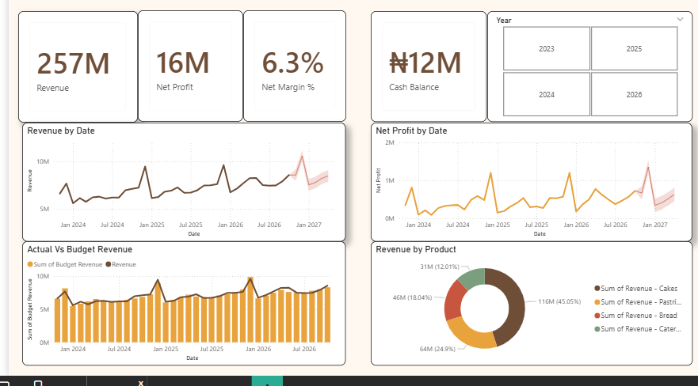
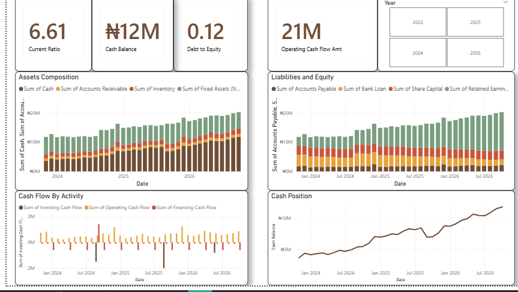

# CodeAlpha_FinancialHealthDashboard

Power BI financial health dashboard built on simulated SME data (CodeAlpha internship, Task 1).

## About the data
The dataset is simulated. It covers a fictional bakery, Crumb & Co., for 36 months (Nov 2023 to Oct 2026), in Naira. It has four tables: Income Statement, Balance Sheet, Cash Flow and Budget.

## What the dashboard shows
**Page 1: Profitability**
- Revenue, net profit, net margin and cash balance
- Revenue and net profit trends, with a 6-month forecast
- Actual vs budget revenue
- Revenue by product
- Year slicer

**Page 2: Financial Position**
- Current ratio, debt to equity, cash balance and operating cash flow
- Assets composition and liabilities and equity over time
- Cash flow by activity and cash position

## Key insights
- Revenue grows steadily and peaks every December.
- Net margin is about 6%, and operating cash flow is healthy.
- Current ratio is about 6.6, which shows idle cash that could be invested.
- Borrowing is low, with debt to equity of about 0.12.

## Tools
Power BI (Power Query, DAX measures, forecasting) and Excel.

## Files
- Power BI report (.pbix)
- CodeAlpha_Financial_Dataset.xlsx: the simulated dataset
- Dashboard screenshots
